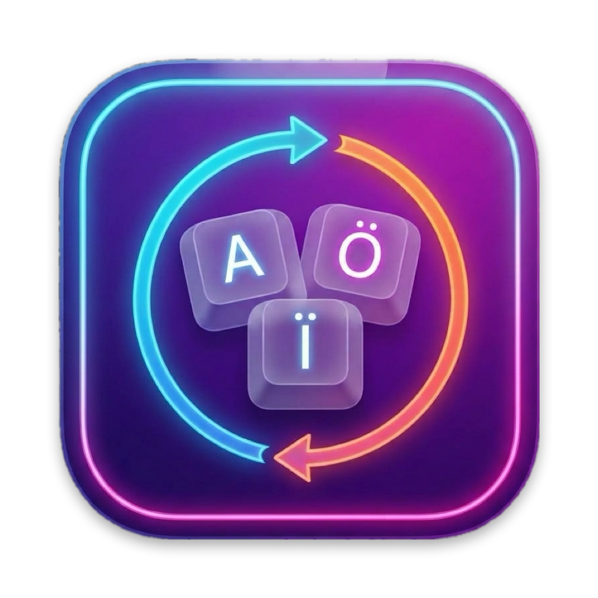

<p align="center">
  
</p>

<h1 align="center">LangCycle</h1>

<p align="center">
  <a href="https://github.com/mavr1k/LangCycle/actions/workflows/ci.yml"></a>
</p>

A tiny macOS menu bar app that switches keyboard layouts the way Windows does: every press of the hotkey moves to the **next layout in a fixed order** (A → B → C → A). It then shows a **large HUD** with the language you picked, so you can see it at a glance.

- **⌃Space** selects the next layout and **⌃⇧Space** the previous one. You can choose ⌥Space or ⌘Space instead.
- The result never depends on how fast you press or whether you let go of the modifier. Pressing, releasing and pressing again always moves forward.
- The HUD never takes focus or blocks clicks, and it also appears over fullscreen apps and on every Space. It stays visible while you hold any key of the hotkey (⌃, ⌥ or ⌘, Space, and ⇧ for the reverse hotkey) and fades out 1 s after you let go of all of them.
- The menu bar shows the current layout's code (`EN`, `УК`, `DE`…), even when you switch some other way.
- No dependencies, no network access, no analytics, and no permissions to grant.

## Requirements

- macOS 13 or later, on Apple Silicon or Intel (the app is a universal build).
- To build from source only: Apple's Command Line Tools (`xcode-select --install`). Xcode is not needed.

## Install

LangCycle is not notarized by Apple (that needs a paid Apple Developer account); it is only ad-hoc signed. So macOS treats a downloaded copy as coming from an unidentified developer. Both ways below deal with that.

### Homebrew

```sh
brew install --cask mavr1k/tap/langcycle
```

The cask removes the download quarantine flag after installing, so macOS shows no warning.

### Download

1. Download `LangCycle-<version>.zip` from the [Releases page](https://github.com/mavr1k/LangCycle/releases) and unzip it.
2. Drag `LangCycle.app` into `/Applications`.
3. Open it. macOS refuses the first time with a message that Apple could not verify it. Click **Done**, then open **System Settings → Privacy & Security**, scroll down to **Security**, and click **Open Anyway** next to "LangCycle was blocked". Confirm with your password. You only do this once.

   On macOS 13 and 14 you can instead right-click the app and choose **Open**. Or, in Terminal: `xattr -dr com.apple.quarantine /Applications/LangCycle.app`.

After installing, follow [First run](#first-run-turn-off-the-macos-shortcut-required) below.

### Build from source

```sh
./build.sh               # build a universal LangCycle.app, install it to /Applications and launch it
./build.sh --no-install  # build only: build/LangCycle.app
./test.sh                # run the unit tests
```

`build.sh` builds arm64 and x86_64 separately with SwiftPM, merges them with `lipo`, and ad-hoc signs the bundle.

`test.sh` runs `swift test`. With only the Command Line Tools installed, SwiftPM can't find the Swift Testing macro plugin by itself, so the script passes its location. With Xcode installed, plain `swift test` works.

## First run: turn off the macOS shortcut (required)

macOS uses ⌃Space for its own input switcher. While that shortcut is on, macOS handles the key first and LangCycle never sees it. Turn it off once:

1. Open **System Settings → Keyboard → Keyboard Shortcuts… → Input Sources**.
2. Untick **Select the previous input source** and **Select next source in Input menu**.
3. If you choose ⌘Space as the hotkey, also untick **Spotlight → Show Spotlight search**.

LangCycle shows these steps on first launch, and later under **Setup Help…** in its menu. While a macOS shortcut still conflicts with the chosen hotkey, the menu shows **⚠︎ Shortcut unavailable — disable the system one**. The same warning appears if another app has already taken the key combination.

## Menu

| Item | What it does |
|---|---|
| Layout list | Click to select a layout. The current one has a checkmark. |
| Hotkey | Choose ⌃Space, ⌥Space or ⌘Space. Adding ⇧ always goes backwards. |
| HUD Size | Small, Medium or Large. |
| Show HUD | Turn the HUD off to keep only the menu bar code. |
| Skip Layouts | Leave layouts out of the cycle while keeping them enabled in macOS. |
| HUD Labels | Rename the big name the HUD shows for a layout (see below). |
| Launch at Login | Uses `SMAppService`. macOS may ask you to approve it in System Settings → General → Login Items. |
| Setup Help… | The steps for turning off the macOS shortcut. |
| About LangCycle | Version, author and a short bio. The text is in `Sources/LangCycle/About.swift`. |

Settings are stored in the `com.local.langcycle` defaults domain.

### Renaming HUD labels

By default the HUD shows each language's own name as the headline ("English", "Українська", "Deutsch") and the macOS layout name ("ABC", "Ukrainian", "German") underneath it. To use your own wording:

1. Open **HUD Labels** in the menu and click a layout. A checkmark marks layouts that already have a custom label.
2. Type the new label and press **Save**. Labels are limited to 30 characters.
3. To go back to the automatic name, press **Reset to Default**, or save an empty label.

Labels are saved per layout (by its macOS input source ID), so they survive restarts and reordering. They only change the big name in the HUD. The short codes (`EN`, `УК`…) and the names in the menu stay as they are.

## How the next layout is chosen

The layout list comes from macOS: the enabled keyboard layouts, in the order shown in System Settings → Keyboard → Input Sources. It is read again on every press, so adding or removing a layout takes effect immediately.

Right after LangCycle selects a layout, macOS can still report the old one for a short time. So a press within **0.8 s** of LangCycle's last switch continues from the layout LangCycle just picked. Any later press continues from the layout that is actually active, including one you picked with the mouse or another shortcut.

This logic is a pure function, `nextLayout(...)` in `Sources/LangCycleCore/Cycle.swift`, and is covered by the unit tests.

## Permissions and privacy

- **No permissions are needed.** The hotkey uses Carbon's `RegisterEventHotKey`, which does not need Accessibility or Input Monitoring access and keeps the key from reaching the app you are typing in.
- **Keystrokes:** only the registered hotkey reaches the app. Nothing is logged.
- **Network:** the app contains no network code. You can confirm with `lsof -i -a -p $(pgrep -x LangCycle)` or `nettop`.
- **Secure input** (password fields, Terminal → Secure Keyboard Entry): Carbon hotkeys usually keep working while secure input is on. **This has not been verified for this build yet.** To check, turn on Terminal → Secure Keyboard Entry, focus Terminal and press the hotkey.

## Project layout

```
Sources/LangCycleCore/Cycle.swift     pure logic: next/previous layout, short codes, native language names
Sources/LangCycle/main.swift          app delegate, menu bar item and menu, settings, single instance
Sources/LangCycle/Hotkey.swift        Carbon hotkeys, presets, detection of conflicting macOS shortcuts
Sources/LangCycle/InputSources.swift  thin wrapper over Text Input Sources (TIS)
Sources/LangCycle/HUD.swift           the indicator panel
Sources/LangCycle/About.swift         the text of the About window
Tests/LangCycleCoreTests/             unit tests (Swift Testing)
Resources/Info.plist                  LSUIElement agent app, bundle id com.local.langcycle
```

## Uninstall

1. Turn off **Launch at Login** in the menu, then choose **Quit LangCycle**.
2. Run:
   ```sh
   rm -rf /Applications/LangCycle.app
   defaults delete com.local.langcycle
   ```
   If you installed with Homebrew, run `brew uninstall --cask --zap langcycle` instead. It removes the app and the saved settings.
3. If you want macOS's own shortcut back, tick it again in System Settings → Keyboard → Keyboard Shortcuts… → Input Sources.

## Releasing (maintainers)

GitHub Actions does the work. The **CI** workflow runs the tests and a universal build on every push and pull request. The **Release** workflow publishes versions.

**Every push to `main` that changes the app is released automatically.** That means a change under `Sources/`, `Resources/`, `Package.swift` or `build.sh`; docs, tests and workflow changes don't release. The workflow runs the tests, builds and checks the zip, creates the GitHub release (the notes list the commit subjects since the last release, and you can edit them afterwards) and updates the cask in [mavr1k/homebrew-tap](https://github.com/mavr1k/homebrew-tap). Everyone who installed with Homebrew gets it with `brew upgrade --cask langcycle`.

How the version is chosen (`./next-version.sh`):

- Normally the patch number of the latest tag goes up by one: `v1.1` → `1.1.1` → `1.1.2`.
- To start a new line, raise `CFBundleShortVersionString` in `Resources/Info.plist` (for example to `1.2`) in a change to the app. That exact version is released, and patch numbers count up from it again.
- The version is stamped into the build and is not committed back, so the workflow never pushes to `main`. The version in `Info.plist` only matters as the marker for a new line, so local builds show whatever it says.

Other ways to release:

- **Skip a release:** put `[skip release]` in the last commit message of the push.
- **Pick the exact version yourself:** push a tag, for example `git tag -a v2.0 -m "LangCycle 2.0" && git push origin v2.0`.
- **Try it without publishing:** run **Release** by hand from the Actions tab. It builds and checks everything and keeps the files as a workflow artifact.

One-time setup for the cask update: create a [fine-grained token](https://github.com/settings/personal-access-tokens/new) limited to the `mavr1k/homebrew-tap` repository with **Contents: read and write**, then store it as the secret `TAP_GITHUB_TOKEN` (`gh secret set TAP_GITHUB_TOKEN -R mavr1k/LangCycle`). Without it the release is still created, but the workflow only prints a notice that the cask was not updated, and Homebrew users don't get the new version. The token expires on the date you chose, so renew it before then.

`./release.sh` builds the same files locally (set `LANGCYCLE_VERSION` to choose the version), and `./release-notes.sh v1.2` prints the release notes.

## About

Made by **mavr1k**. The same details are shown in the app, under **About LangCycle** in the menu.

- GitHub: [github.com/mavr1k](https://github.com/mavr1k)
- LinkedIn: [linkedin.com/in/mavrosaus](https://www.linkedin.com/in/mavrosaus/)
- Email: [hard359@gmail.com](mailto:hard359@gmail.com)

## License

MIT. See [LICENSE](LICENSE).
